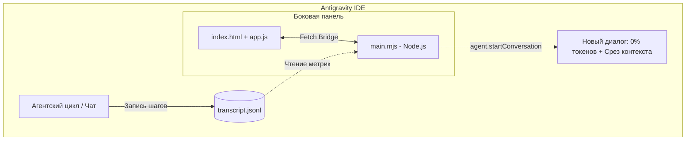

<div align="center">

# ⚡ Context Monitor for Google Antigravity

**Token Weather & Context Handoff — наглядный контроль контекста и перенос сессий без потерь**

[](https://antigravity.google)
[](https://nodejs.org)
[](https://claude.ai)
[](LICENSE)

</div>

---

## 🎯 О проекте

Плагин создан **специально для IDE Google Antigravity**.

Идея родилась из нехватки нативного аналога команды **/compact из Claude Code**. В Claude Code компактизация позволяет сжать разросшуюся историю сессии и продолжить диалог без потери фокуса. В Antigravity агент сохраняет историю в журнал без физической обрезки на лету, из-за чего длинные задачи постепенно исчерпывают окно внимания.

**Context Monitor** переносит философию `/compact` в экосистему Antigravity:
1. **Token Weather (Погода токенов):** выводит в боковую панель (Aux Pane) реальную шкалу заполнения 1.0M контекстного окна Gemini.
2. **Бесшовный Handoff:** формирует компактный архитектурный срез сессии и в 1 клик стартует новый чистый диалог (**0% токенов**), передавая новому агенту всю выжимку проекта.

---

## 🖥 Как это выглядит в боковой панели

```text
┌────────────────────────────────────────────────────────┐
│  ⚡ Context Monitor                                [⚙] │
├────────────────────────────────────────────────────────┤
│  ● Активный диалог: 0c8ee9b2...                        │
│                                                        │
│  [██████████████░░░░░░░░░░░░░░░░░░░] 34% (341k / 1.0M) │
│                                                        │
│  ┌───────────────────────┬──────────────────────────┐  │
│  │ 📥 Входные: 120 450   │ ⚡ Кэш: 221 100          │  │
│  │ 📤 Ответы:   12 300   │ 🔄 Шагов: 48             │  │
│  └───────────────────────┴──────────────────────────┘  │
│                                                        │
│  [ 🚀 Сформировать срез и начать новый диалог ]        │
└────────────────────────────────────────────────────────┘
```

---

## ✨ Ключевые возможности

| Функция | Описание |
|---|---|
| **Честный расчет метрик** | Считывает реальные `input_tokens` и `cache_read_tokens` напрямую из системного журнала `transcript.jsonl`. |
| **Шкала 1.0M токенов** | Калибровка под полное окно контекста Gemini Flash (никаких искусственных ограничений). |
| **1-Клик Handoff через Gemini API** | Мгновенная автоматическая генерация сводки через фоновый запрос к модели. |
| **Локальный режим (без API-ключей)** | Двухэтапный сценарий переноса через текущего агента без внешних сервисов. |
| **Нативный Sidecar SDK** | Работает прямо в правой боковой панели (Aux Pane) на официальном SDK Antigravity. |

---

## 🏗 Архитектура



---

## 🚀 Быстрая установка

### Способ 1: Через Git (рекомендуется)

Клонируйте репозиторий напрямую в каталог плагинов Antigravity:

**Windows (PowerShell):**
```powershell
git clone https://github.com/ВАШ_ЛОГИН/context-monitor.git "$HOME\.gemini\config\plugins\context-monitor"
```

**macOS / Linux:**
```bash
git clone https://github.com/ВАШ_ЛОГИН/context-monitor.git ~/.gemini/config/plugins/context-monitor
```

### Способ 2: Вручную

1. Скачайте репозиторий архивом (ZIP).
2. Распакуйте папку `context-monitor` в директорию плагинов:
   - **Windows:** `C:\Users\<Ваш_Пользователь>\.gemini\config\plugins\context-monitor`
   - **macOS / Linux:** `~/.gemini/config/plugins/context-monitor`
3. Перезапустите Antigravity (или выполните перезагрузку плагинов).

---

## 🎮 Использование

1. Откройте правую панель (**Aux Pane**) в Antigravity.
2. Выберите виджет **Context Monitor**.
3. Следите за шкалой во время работы — она обновляется автоматически каждые 5 секунд.
4. Когда контекст перевалит за 40–50%, нажмите кнопку **«Сформировать срез и начать новый диалог»**:
   - Плагин создаст структурированный файл сводки.
   - Автоматически откроется новый диалог, готовый сразу продолжать вашу задачу с чистой памятью.

---

## 📂 Структура репозитория

```text
context-monitor/
├── plugin.json              # Манифест плагина для Antigravity
├── assets/
│   └── logo.svg             # Иконка виджета
├── sidecars/panel/
│   ├── sidecar.json         # Регистрация UI в Aux Pane
│   ├── package.json         # Модуль Node.js
│   ├── main.mjs             # Сервер: расчет токенов, роутинг, Handoff
│   ├── index.html           # Интерфейс виджета
│   ├── app.js               # Клиентские таймеры и вызовы Host Bridge
│   └── styles.css           # Тема и стили оформления
├── .gitignore               # Исключение локальных данных
├── LICENSE                  # Лицензия MIT
└── README.md                # Документация проекта
```

---

## 💬 От автора

> *Пользуйтесь на здоровье! Сделал этот инструмент в первую очередь для себя, чтобы не упираться в лимиты контекста во время плотных сессий разработки в Antigravity. Но буду очень рад, если он сбережет время и нервы кому-то ещё.* 🙂
