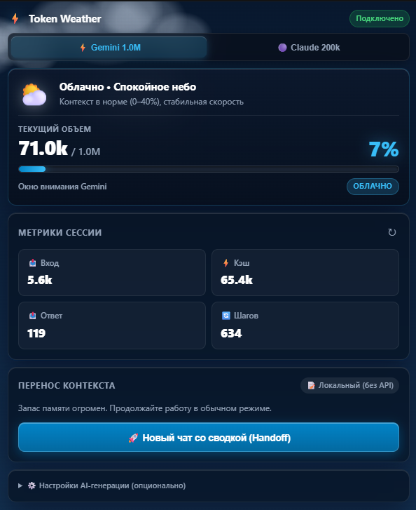
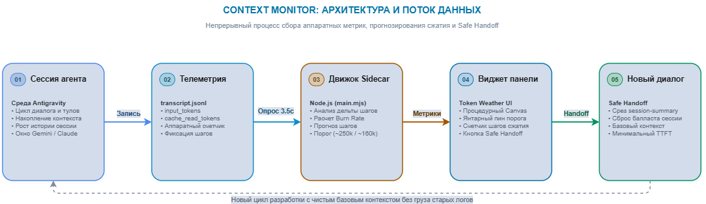

<div align="center">

# ⚡ Context Monitor for Google Antigravity

**Token Weather & Safe Handoff — visual context telemetry, dynamic weather canvas, and lossless session migration without task drift**

[](https://github.com/bekirand/context-monitor)
[](https://nodejs.org)
[](https://claude.ai)
[](LICENSE)

<br/>

**[Документация на русском](README.md)**

</div>

---

## 🎯 About the Project

This plugin was built **specifically for the Google Antigravity IDE**.

The idea was born out of a real pain point: the lack of visual context telemetry and a native equivalent of the **/compact command from Claude Code**.  
In Antigravity, developers have historically been in a "blind spot" — there is no visible token gauge, no easy way to know whether memory is sitting at 20k or 250k, why the agent starts lagging, or exactly when automatic compaction will strike.

**Context Monitor** solves this:
1. **Token Weather:** A procedural Canvas 2D background and synchronized gauge that dynamically adapts to context usage:
   - **⛅ 0–40% — Cloudy:** Calm azure sky, drifting procedural clouds, minimal memory footprint.
   - **🌧️ 40–70% — Rain:** Steel sky, realistic raindrops, subtle recommendation to prepare a Handoff.
   - **⛈️ >70% — Storm:** Heavy storm clouds, downpour, branching lightning bolts, warning red pulse.
2. **Antigravity Auto-compaction Forecasting:** Calculates adaptive context consumption (Burn Rate), marks an amber threshold tick on the gauge, and estimates remaining steps before forced compaction.
3. **Safe Handoff:** Extracts an architectural snapshot of the task (via background Gemini API or local in-dialogue agent) and initiates a clean, isolated session without residual garbage.

> [!NOTE]
> **Upcoming Claude Opus 5.5 & Sonnet 5.5 Support (02.11.2026):**  
> The Antigravity update scheduled for **02.11.2026** is slated to introduce flagship **Claude Opus 5.5** and **Claude Sonnet 5.5** models. Complex reasoning workloads with deep context will surge — making Context Monitor's `Claude (200k)` preset, visual Token Weather, and predictive Safe Handoff essential for smooth, uninterrupted development.

---

## 🧠 Native Auto-compaction vs Clean Slate (Safe Handoff)

Antigravity features its own automatic session compression engine (**Auto-compaction / Truncation**). When a dialogue swells to critical limits, the platform forcibly truncates previous messages.

### What Antigravity Does Under the Hood:
* **Empirical Threshold (~250k tokens):** For Gemini-family models (1.0M window), system compaction typically triggers around **~250,000 tokens** (~25% of total capacity).
* **Environment Server Restart:** During compaction, the IDE halts all active background processes, daemons, and running subagents.
* **Background Summarization:** An internal agent compiles a `<CONTEXT_SUMMARY>` block (goals, progress, artifacts), pruning raw prior turns from the prompt.
* **Hidden Baseline Overhead:** The first prompt immediately following auto-compaction carries **~30k–55k tokens** of residual memory (summary + system rules + tool caching).

---

### ⏱️ Real-Time Compaction Forecasting

Rather than getting caught off guard by a surprise memory wipe, Context Monitor continuously runs predictive calculations:
* **Calibrated Scale Thresholds:**
  - **Gemini (1.0M):** Target threshold at **~250k tokens** (amber marker at **25%**).
  - **Claude (200k):** Target threshold at **~160k tokens** (amber marker at **80%**).
* **Adaptive Burn Rate:** Analyzes rolling token intake over recent session steps from `transcript.jsonl` (averaging ~5k–10k tokens per turn).
* **Remaining Steps Counter:** Distinct `⚡ Antigravity Auto-compact` card displaying `~X steps remaining` and exact tokens left before the cutoff.
* **Storm Alert (`forecast-alert`):** When under 25k tokens remain, the card pulses in warning coral: *“⚠️ ~1-2 steps left. Safe Handoff recommended”*, allowing developers to capture task state before forced truncation.

---

### Comparison: Native Auto-compaction vs Safe Handoff

| Feature | Native Auto-compaction (Antigravity) | Clean Session via Context Monitor (Safe Handoff) |
|---|---|---|
| **Convenience** | **Zero actions:** Uninterrupted background operation. | Requires clicking Handoff and opening a fresh dialogue. |
| **Starting Memory** | **~30k–55k tokens** (residual cache and compressed history). | **Baseline context** (clean slate without old tool call logs or shell dumps). |
| **History & Artifacts** | Retains original `conversation_id` and complete `transcript.jsonl`. | Starts fresh while carrying forward only relevant state. |
| **Task Prompt Control** | Automated internal summary using platform-default templates. | **Structured snapshot** injected as the starting prompt (goals, decisions, file paths). |
| **Background Tasks** | Abruptly kills running subagents and background tasks. | Deliberate step completion without unexpected process crashes. |

---

### When Safe Handoff is Objectively Better:

1. **Major Phase Transitions (Preventing Context Contamination):**  
   After finishing UI design or research, carrying 50k tokens of CSS details into backend implementation pollutes attention. A fresh session focuses the model solely on the task ahead.
2. **Breaking Error Loops (Eliminating "Error Bias"):**  
   If an agent gets trapped in hallucinated debugging steps, auto-compaction bakes those mistakes into the summary. A clean handoff resets accumulated hallucinations.
3. **Compact-Window Models (Claude 3.5 Sonnet / Opus — 200k):**  
   With a 200k limit, the `Claude (200k)` preset marks the threshold at ~160k (80%), giving you plenty of runway to migrate cleanly before hitting hard limits.
4. **Lower Latency (Time-To-First-Token):**  
   A clean prompt without a massive history prefix delivers noticeably faster model responses.

---

## 🖥 Side Panel Preview

Side-by-side comparison of both modes — **Gemini (1.0M)** preset on the left and **Claude (200k)** on the right with customized threshold calibration:

<p align="center">
  
</p>

---

## ✨ Key Features (v1.1.0)

| Feature | Description |
|---|---|
| **🔮 Floating Glass HUD for Antigravity App** | Persistent real-time widget right inside the standalone Antigravity Electron app. Compaction countdown (`⚡ 57.1k/250k (23%) • ~32 steps`), draggable, auto-persisted coordinates, minification, quick close `(×)` button, and sidecar panel visibility toggle. |
| **📊 Live Status Bar Telemetry (IDE)** | Persistent token counts, weather icon, and countdown steps right in the bottom status bar (`⛅ 83.7k/250k (8%) \| ⚡ ~21 steps`). No need to keep the Aux Pane open! |
| **✨ Auto Model Detection (Auto)** | Automatically detects Gemini (1.0M window, 250k threshold) or Claude (200k window, 160k threshold) and adapts gauge calibration dynamically. |
| **🛠️ Agent Activity & Cache Chips** | Clean minimal badges showing total agent actions (`👁️ reads`, `⚡ commands`, `✏️ edits`) and cache efficiency (`⚡ 92% from cache`). |
| **Precise Metrics Engine** | Reads actual `input_tokens` and `cache_read_tokens` directly from the active `transcript.jsonl` session log. |
| **Auto-compaction Prediction** | Amber threshold indicator (25% / 80%) with an adaptive Burn Rate step counter. |
| **Live Canvas 2D Sky** | Procedural sky, drifting clouds, 3-layer parallax raindrops, and realistic branching lightning on a lightweight native 2D Canvas. |
| **Color Harmonization** | Percentage typography, progress bars, and weather badges transition synchronously across Cyan (Cloudy), Ice Blue (Rain), and Rose Crimson (Storm). |
| **Hybrid Safe Handoff** | Structured task summaries generated via external Gemini API or directly through the local in-dialogue agent. |
| **Native Sidecar SDK** | Seamlessly docks in the Antigravity Aux Pane via official Sidecar SDK with zero external runtime overhead. |

---

## 🏗 Architecture

<p align="center">
  
</p>

---

## 🚀 Quick Installation

### 1. Install as Antigravity Plugin (Aux Pane Side Panel)

Clone this repository into your Antigravity plugins directory:

**Windows (PowerShell):**
```powershell
git clone https://github.com/bekirand/context-monitor.git "$HOME\.gemini\config\plugins\context-monitor"
```

**macOS / Linux:**
```bash
git clone https://github.com/bekirand/context-monitor.git ~/.gemini/config/plugins/context-monitor
```

### 2. Install Desktop Floating HUD into Antigravity (Electron Manager)

To enable the floating HUD pill inside the standalone Antigravity application:

```powershell
cd "$HOME\.gemini\config\plugins\context-monitor"
npm run patch-app
```

> **Safe & Reversible:** Creates a full backup copy (`app.asar.bak`).  
> To instantly revert back to vanilla state:
> ```powershell
> npm run unpatch-app
> ```

### 3. Install into IDE Status Bar (Status Bar Countdown)

To enable the bottom status bar item inside Antigravity IDE, copy the extension:

**Windows (PowerShell):**
```powershell
Copy-Item -Recurse -Force "$HOME\.gemini\config\plugins\context-monitor" "$HOME\.antigravity-ide\extensions\bekirand.context-monitor-1.1.0"
```

Then restart the IDE — the live countdown will appear in the bottom right corner of your status bar. Clicking it immediately toggles the side panel!

---

## 🎮 How to Use

1. **Desktop Floating HUD:** In the Antigravity chat manager window, an elegant frosted glass pill shows live token consumption and compaction countdown. Drag it anywhere, minimize it, click `(i)` for complete metrics breakdown, or hide it using `(×)` / the sidecar toggle button.
2. **Status Bar in IDE:** The live context volume and compaction countdown are always visible at the bottom: `⛅ 83.7k/250k (8%) | ⚡ ~21 steps`. Hover for detailed telemetry.
3. **Side Panel (Aux Pane):** Open the right panel in Antigravity (or click the status bar item).
4. **Model Profile:** Defaults to **✨ Auto** (auto-detection). You can also manually lock to **Gemini 1.0M** or **Claude 200k**.
5. **Agent Activity:** Monitor tool executions, terminal commands, and prompt cache hit rate in real time.
6. **Safe Handoff:** When storm conditions strike (>70%), click **"Generate Snapshot & Start New Chat"** to migrate cleanly without context degradation.

---

## 💬 Note from the Author

> *Enjoy! I built this tool for myself to avoid slamming into context walls during intense development sessions in Antigravity. I hope it saves you time and keeps your workflow uninterrupted.* 🙂
